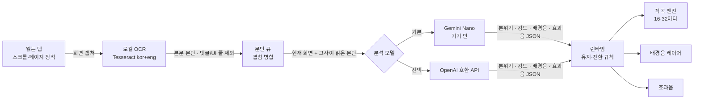

# TWICE

**2026 고려대학교 정보대학 InThon / Hackathon Track**에서 **17팀 Seventeen**이 만든 프로젝트입니다. 대회 주제인 **감각**을 독서와 소리의 연결로 풀어냈습니다.

웹 소설 화면의 분위기를 읽어 실시간으로 음악·배경음·효과음을 합성하는 온디바이스 Chrome 확장 프로그램입니다.

읽는 화면만 보고 장면에 맞는 소리를 이어 붙입니다. 사이트마다 연동하거나 미리 분석해 둘 필요가 없습니다. 기본은 기기 안에서만 동작하며(Tesseract OCR + Chrome의 Gemini Nano + Web Audio 합성), 원하면 OpenAI 호환 API로 분석 모델만 바꿀 수 있습니다.

## 시작하기

[Releases](https://github.com/nulLeeKH/TWICE/releases)에서 `twice-<버전>-chrome.zip`을 받거나, 직접 빌드합니다.

```bash
pnpm install --frozen-lockfile
pnpm build   # .output/chrome-mv3 폴더
pnpm zip     # .output/twice-<버전>-chrome.zip (드래그 앤 드롭 설치용)
```

1. Chrome `chrome://extensions`에서 **개발자 모드**를 켜고, **Load unpacked**로 `.output/chrome-mv3` 폴더를 로드하거나 zip 파일을 페이지에 끌어놓아 설치합니다.
2. 웹 소설 탭에서 툴바의 **TWICE** 아이콘을 눌러 사이드 패널을 엽니다.
3. 모델이 준비되지 않았다면 **준비**를 눌러 Gemini Nano를 준비하거나, 외부 LLM을 사용할 예정이라면 설정에 진입해 OpenAI 호환 API를 설정합니다.
4. **시작**을 눌러 현재 탭에 대해 분석을 시작합니다. 같은 버튼으로 멈춤·재개합니다.

## 동작 방식



- **화면 OCR**: 현재 보이는 본문 영역만 캡처해 로컬 Tesseract(`kor+eng`)로 읽습니다. 댓글 제목·날짜·버튼 같은 줄은 OCR 단계에서 먼저 걸러 냅니다.
- **AI 분석**: 한국어·영어 원문을 번역 없이 AI 모델에 바로 전달합니다. 기본은 온디바이스 Gemini Nano이고, 설정의 **외부 API** 탭에서 Base URL과 API 키를 넣고 **연결하고 모델 불러오기**를 누르면 OpenAI 호환 API로 바뀌고, 서버의 모델 목록에서 고를 수 있습니다. 모델은 분위기 16종 중 하나와 강도만 고릅니다.
- **분석 큐**: 캡처마다 바로 OCR해 쌓아 두고, 진행 중인 분석은 끝까지 마칩니다. 그 사이 읽은 화면은 다음 요청에 한 번에 묶어 보내며, 마지막 화면이 현재 화면이 됩니다.
- **경고**: 분석이 실패하면(외부 API 연결 오류 포함) 상단에 이유와 **다시 시도** 버튼을, 외부 API라면 **설정 열기**도 띄웁니다. 응답이 15초를 넘기면 지연 경고를 보여 줍니다. 기기 안 AI를 쓸 수 없으면 모델 카드에서 바로 외부 API로 전환할 수 있습니다.
- **침묵**: 모델이 침묵을 고르면 소리를 완전히 낮추고, 다시 이야기가 이어진다고 판단할 때까지 유지합니다. 시간 제한은 없고, 침묵 중에는 모델에게 이를 알려 줍니다.
- **음악·배경음·효과음**:
  - 음악은 분위기 프리셋(악기 조합·BPM 범위·음계)으로 코드 진행과 멜로디를 가진 16·32마디 곡을 작곡하고, 끝나면 같은 분위기의 새 곡으로 이어갑니다.
  - 분위기 전환은 최소 20초(비슷한 분위기는 60초) 유지 후 다음 마디에서 4초 이상 크로스페이드합니다. 전투·공포는 바로 끼어듭니다. 그 사이에는 곡을 유지한 채 강도만 따라갑니다.
  - 배경음은 최대 2개 레이어이며, 음량이 불규칙하게 오르내리고 가끔 잦아듭니다. 고역 잡음은 눌러 묘사하려는 소리를 앞세웁니다.
  - 효과음은 현재 화면의 물리적 소리 1개만 8초 간격으로 재생하며, 재생마다 거리·타이밍이 조금씩 다릅니다. 장면 이동·침묵·비본문 진입 시 해제합니다.
- **볼륨**: 음악·배경음·효과음·전체를 따로 조절하고, 각각 음소거할 수 있습니다. 음소거해도 슬라이더 값은 그대로 남습니다.
- **탭·회차 연동**: 다른 탭을 볼 때는 자동 일시정지하고 돌아오면 이어서 재생합니다. 같은 작품의 다음 화로 이동하면 음악과 맥락을 유지하고, 다른 작품·사이트로 벗어나면 맥락을 비우고 일시정지합니다. 본문을 벗어난 댓글 구간에서 돌아오면 모델을 기다리지 않고 바로 소리를 되살립니다.

## 기술 포인트

- **조합형 작곡 엔진** (`src/audio/music.js`): 분위기마다 음계·BPM 범위·주/보조 악기·반주 방식을 정해 두고, 곡마다 조·템포·4마디 프레이즈의 화음(으뜸→버금딸림→딸림 종지)·멜로디 리듬 모티프를 새로 조합합니다. 형식은 A-B(16마디) 또는 A-A-B-A(32마디)입니다. 다음 곡은 조와 템포를 이전 곡 가까이 잡아 이어집니다.
- **모델은 고르기만, 소리는 엔진이**: 모델 응답은 분위기 enum과 0–1 강도, 배경음·효과음 목록뿐입니다(`src/domain/score.js`의 JSON Schema). 출력이 짧아 응답이 빠르고, 악기·템포는 엔진이 정해 결과가 일관됩니다.
- **음악 먼저 적용**: Nano의 스트리밍 응답을 읽는 도중 완성된 필드부터 적용합니다. 음악 → 배경음 → 효과음 순서입니다. 외부 API는 스트리밍 없이 응답이 끝나면 한 번에 적용합니다.
- **끊김 없는 전환**: 같은 분위기는 곡을 유지한 채 강도만 다음 마디부터 반영하고, 분위기가 바뀌면 새 곡을 마디 경계에서 시작해 이전 곡과 겹쳐 페이드합니다. 배경 화음은 같은 화음이 이어지는 동안 다시 치지 않습니다.
- **로컬 OCR 파이프라인**: 스크롤이나 페이지 넘김이 멈추면 캡처하고(최소 0.65초 간격), 같은 화면은 OCR 결과를 재사용합니다. 겹치는 스크롤 화면은 문단 단위로 병합해 중복 없이 모델에 보냅니다.

## 개인정보

기본(Gemini Nano)에서는 화면 캡처, OCR 텍스트, 독서 맥락을 사이드 패널 메모리에서만 처리하며 외부 서버로 전송하지 않습니다.

설정에서 **외부 API**를 직접 연결한 경우에만, 화면에서 읽은 본문과 독서 맥락이 입력한 서버(`{Base URL}/chat/completions`)로 전송됩니다. 연결할 때 그 서버에 대한 접근 권한을 요청하고, 사용 중에는 상단에 `외부 API` 표시가 나타납니다. 외부 요청이 실패해도 Nano로 자동 전환하지 않습니다. 화면 캡처 이미지는 보내지 않습니다.

브라우저 저장소(`storage.local`)에는 볼륨·음소거, 인터페이스 언어(`ko`/`en`), 분석 모델 설정을 저장합니다. 외부 API 키는 이 기기의 확장 저장소에 암호화 없이 저장됩니다.

## 개발 환경

Node.js 24, pnpm 10, 그리고 온디바이스 AI를 쓸 수 있는 데스크톱 Chrome이 필요합니다. Nano는 실제 사용자 프로필에서만 동작하므로 개발 서버가 브라우저를 자동으로 띄우지 않습니다(`wxt.config.ts`의 `webExt.disabled`).

1. `pnpm install` 후 `pnpm dev`를 실행합니다.
2. `chrome://extensions`(개발자 모드)에서 `.output/chrome-mv3-dev`를 한 번 로드합니다.
3. 사이드 패널과 `src/` 수정은 저장하면 다시 빌드되어 패널에 반영됩니다. background, `wxt.config.ts`(manifest), `public/reader.js`를 바꿨다면 `chrome://extensions`에서 확장을 새로고침하고 읽던 소설 탭도 한 번 새로고침합니다.
4. 디버깅은 패널을 우클릭 → **검사**, 그리고 패널 아래 **진단**(OCR 원문·모델 입력·응답·실제 적용)을 봅니다. 진단 JSON에는 원문이 들어갈 수 있습니다.

## 개발 명령

```bash
pnpm dev         # 개발 빌드 (.output/chrome-mv3-dev)
pnpm check       # 타입 검사 + 단위 테스트 + 프로덕션 빌드
pnpm test:audio  # Web Audio 오프라인 신호 검증
pnpm test:e2e    # Chrome 확장 + OCR E2E 검증
pnpm zip         # 배포용 zip 생성
```

`test:audio`와 `test:e2e`는 Chrome for Testing을 음소거·임시 프로필로 띄웁니다. 실행 파일 경로는 `CHROME` 환경 변수로 지정합니다(기본값은 puppeteer 캐시의 Chrome for Testing 152). e2e는 실제 확장·실제 OCR에 가짜 모델을 붙여 돌립니다.

| 검사 | 범위 | 최근 결과 |
|---|---|---|
| `pnpm check` | 모델 수명·외부 API·전환 규칙·작곡·병합·i18n·런타임 단위 테스트, 타입, 빌드 | 51/51 |
| `pnpm test:audio` | 분위기 16종 출력, 전환 크로스페이드 무음 없음, 마디 끝 무음 없음, 클리핑, 덕킹·일시정지, 메인 스레드 정지 중 재생, 효과음 47종 음량·피크 리포트 | 27/27 |
| `pnpm test:e2e` | 모델 없음·다운로드 흐름, 실제 OCR, 음악→배경 순서, 큐 병합, 탭·회차·이탈, 댓글 구간 진입·복귀, 실패 경고·재시도, 음소거, 한/영 UI, 오프라인 라이선스·원문 링크 | 46/46 |

## 개발 프로세스

버전은 [SemVer](https://semver.org/lang/ko/)를 따르고, `main`에 머지된 버전만 릴리즈합니다.

1. `main`에서 작업 브랜치를 만듭니다 (`feat/…`, `fix/…`).
2. 개발하고 `pnpm check`, `pnpm test:audio`, `pnpm test:e2e`를 통과시킵니다.
3. PR을 올리기 전에 버전을 올려 같은 브랜치에 커밋합니다.
   ```bash
   pnpm version patch --no-git-tag-version   # 또는 minor / major
   git commit -am "chore: release vX.Y.Z"
   ```
4. PR을 열고 리뷰 후 `main`에 머지합니다.
5. 머지된 `main`에서 태그를 달고 빌드 결과를 GitHub 릴리즈로 등록합니다.
   ```bash
   git switch main && git pull
   pnpm install --frozen-lockfile && pnpm zip
   (cd .output && shasum -a 256 twice-X.Y.Z-chrome.zip > SHA256SUMS)
   git tag -a vX.Y.Z -m "TWICE vX.Y.Z" && git push origin vX.Y.Z
   gh release create vX.Y.Z .output/twice-X.Y.Z-chrome.zip .output/SHA256SUMS --title "TWICE vX.Y.Z" --notes-file notes.md
   ```

빌드 결과물(zip)은 저장소에 커밋하지 않고 GitHub 릴리즈 자산으로만 보관합니다.

릴리즈 노트는 짧게 씁니다. 한 줄 요약, 변경 사항 목록, 테스트 결과, zip의 SHA256만 넣고 설치 방법이나 주의 사항은 README에 둡니다.

```markdown
첫 릴리즈입니다.

- 화면 OCR(로컬 Tesseract) → 온디바이스 Gemini Nano 또는 OpenAI 호환 API → 음악, 배경음, 효과음 실시간 합성
- 분위기 16종, 16/32마디 조합형 작곡과 크로스페이드 전환
- 테스트: 단위 51/51, 오디오 27/27, e2e 44/44

SHA256 (twice-0.1.0-chrome.zip): fdf1941d…
```

## 알려진 한계

- **자동 검사는 가짜 모델로만 돌았습니다.** 실제 Gemini Nano의 응답 속도·선택 품질은 실기기에서 따로 확인해야 합니다. 외부 API도 실제 서버에는 아직 연결해 보지 않았습니다.
- Prompt API는 공식적으로 한국어 입력을 지원 언어로 명시하지 않습니다. 원문을 그대로 넣는 방식이 기기·Chrome 버전에 따라 거부되거나 품질이 떨어질 수 있습니다.
- 오디오 검사는 신호 수치(무음·클리핑·변화량)만 확인합니다. 소리가 자연스러운지는 직접 들어 봐야 합니다.
- 회차·작품 구분은 URL 마지막 경로만 비교하는 단순 규칙입니다. 모든 사이트의 뷰어 구조를 지원하지는 않습니다.
- 데스크톱 Chrome 전용입니다.

## 라이선스

TWICE 자체 코드는 [MIT License](LICENSE)로 제공합니다. 상업적 이용·수정·재배포가 가능하며 저작권·허가 고지를 유지해야 합니다. 외부 구성 요소는 각각의 원래 라이선스를 따릅니다.

OCR·WASM 내부 라이브러리, 학습 데이터, 실제 번들에 포함되는 런타임 코드의 원문 고지는 [THIRD_PARTY_NOTICES.md](THIRD_PARTY_NOTICES.md)에 있습니다. 설치한 확장에서는 **설정 → 오픈소스 라이선스**에서 오프라인으로 읽을 수 있으며, ZIP에도 프로젝트 LICENSE·전체 고지·원문 텍스트가 포함됩니다. 검토 범위와 근거는 [라이선스 검토 기록](licensing/REVIEW.md)을 참고하세요.

```bash
pnpm licenses:check       # OCR 자산 해시·고지 원문·의존성 라이선스 점검
pnpm licenses:inventory   # 설치된 개발 의존성 목록 갱신 후 변경 내용 검토
```

일반 빌드와 ZIP 생성 시 실제 런타임 모듈의 이름·버전·라이선스도 검사합니다. 의존성 또는 벤더 파일을 바꾸면 고지·검토 목록을 함께 갱신해야 합니다. Chrome·Nano 모델과 사용자가 연결하는 외부 AI 서비스의 이용 조건은 프로젝트 MIT 라이선스와 별개입니다.
