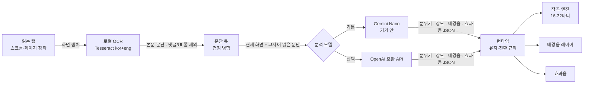

# TWICE

웹 소설 화면의 분위기를 읽어 실시간으로 음악·배경음·효과음을 합성하는 온디바이스 Chrome 확장 프로그램입니다.

접근 가능한 전체 회차 본문이 있으면 장면별로 미리 분석하고, 없으면 보이는 화면의 OCR과 이전 20줄 문맥으로 장면에 맞는 소리를 이어 붙입니다. 사이트마다 연동하거나 미리 분석해 둘 필요가 없습니다. 기본은 기기 안에서만 동작하며(Tesseract OCR + Chrome의 Gemini Nano + Web Audio 합성), 원하면 OpenAI 호환 API로 분석 모델만 바꿀 수 있습니다.

## 시작하기

[Releases](https://github.com/nulLeeKH/TWICE/releases)에서 `twice-<버전>-chrome.zip`을 받거나, 직접 빌드합니다.

```bash
pnpm install --frozen-lockfile
pnpm build   # .output/chrome-mv3 폴더
pnpm zip     # .output/twice-<버전>-chrome.zip (드래그 앤 드롭 설치용)
```

1. Chrome `chrome://extensions`에서 **개발자 모드**를 켜고, **Load unpacked**로 `.output/chrome-mv3` 폴더를 로드하거나 zip 파일을 페이지에 끌어놓아 설치합니다.
2. 웹 소설 탭에서 툴바의 **TWICE** 아이콘을 눌러 사이드 패널을 엽니다.
3. 모델이 준비되지 않았다면 **준비**를 눌러 Gemini Nano를 준비하거나, 외부 LLM을 사용할 예정이라면 설정에 진입해 OpenAI 호환 API를 설정합니다.
4. **시작**을 눌러 현재 탭에 대해 분석을 시작합니다. 같은 버튼으로 멈춤·재개합니다.

## 동작 방식



- **화면 OCR**: 현재 보이는 본문 영역만 캡처해 로컬 Tesseract(`kor+eng`)로 읽습니다. 댓글 제목·날짜·버튼 같은 줄은 OCR 단계에서 먼저 걸러 냅니다.
- **AI 분석**: 한국어·영어 원문을 번역 없이 AI 모델에 바로 전달합니다. 기본은 온디바이스 Gemini Nano이고, 설정의 **외부 API** 탭에서 Base URL과 API 키를 넣고 **연결하고 모델 불러오기**를 누르면 OpenAI 호환 API로 바뀌고, 서버의 모델 목록에서 고를 수 있습니다. 모델은 현재 장면의 실제 감정·위협의 즉시성·시점·맥락을 구분해 분위기 16종 중 하나와 강도를 고릅니다.
- **분석 큐**: 새 캡처는 오래된 미처리 캡처보다 우선합니다. 오래된 화면의 OCR 텍스트는 맥락에 합치되 모델의 음악 판단은 최신 화면을 우선합니다. 외부 API에서는 오래된 요청을 취소하고, Nano는 현재 분석이 끝나면 최신 화면으로 넘어갑니다.
- **경고**: 분석이 실패하면(외부 API 연결 오류 포함) 상단에 이유와 **다시 시도** 버튼을, 외부 API라면 **설정 열기**도 띄웁니다. 응답이 15초를 넘기면 지연 경고를 보여 줍니다. 기기 안 AI를 쓸 수 없으면 모델 카드에서 바로 외부 API로 전환할 수 있습니다.
- **침묵**: 모델이 침묵을 고르면 소리를 완전히 낮추고, 다시 이야기가 이어진다고 판단할 때까지 유지합니다. 시간 제한은 없고, 침묵 중에는 모델에게 이를 알려 줍니다.
- **음악·배경음·효과음**:
  - 음악은 분위기 프리셋(악기 조합·BPM 범위·음계)으로 코드 진행과 멜로디를 가진 16·32마디 곡을 작곡하며 8초 이내 같은 마디 멜로디의 반복을 방지하고, 끝나면 같은 분위기의 새 곡으로 이어갑니다.
  - 분위기 전환은 최소 6초(비슷한 분위기는 10초) 유지합니다. 전투·공포는 즉시 전환 가능하며, 새 음악은 최대 약 0.5초 뒤부터 1.7~2.7초 크로스페이드로 이어집니다.
  - 배경음은 최대 2개 레이어이며, 음량이 불규칙하게 오르내리고 가끔 잦아듭니다. 고역 잡음은 눌러 묘사하려는 소리를 앞세웁니다.
  - 효과음은 현재 화면의 사건을 짧은 **부드러운 악기 연주 액센트**로 표현합니다(피아노·하프·첼로·현악기·마림바). 비명·충돌·동물 소리를 사실적으로 합성하지 않습니다. 한 번에 하나만, 최소 8초 간격으로 재생하고 8초 이내 같은 마디 멜로디를 반복하지 않습니다. 장면 이동·침묵·비본문 진입 시 해제합니다.
- **볼륨**: 음악·배경음·효과음·전체를 따로 조절하고, 각각 음소거할 수 있습니다. 음소거해도 슬라이더 값은 그대로 남습니다.
- **탭·회차 연동**: 다른 탭을 볼 때는 자동 일시정지하고 돌아오면 이어서 재생합니다. 같은 작품의 다음 화로 이동하면 음악과 맥락을 유지하고, 다른 작품·사이트로 벗어나면 맥락을 비우고 일시정지합니다. 본문을 벗어난 댓글 구간에서 돌아오면 모델을 기다리지 않고 바로 소리를 되살립니다.

## 회차 전체 분석 (베타)

- **전체 본문 우선:** 확장 프로그램을 사용자가 시작한 탭에서만 공개적으로 렌더링된 DOM 본문을 탐색합니다. 요청을 새로 보내거나 결제/로그인 제한을 우회하지 않습니다. 본문이 충분히 길고 전체 범위가 문서에 있는 것으로 보일 때만 사전 분석합니다.
- **장면 단위 사전 분석:** 550자 안팎의 연속 문단을 묶어 3,700자 이내 요청 단위로 분석하고, 문단별 분위기와 악기 효과음 시점을 메모리에 보관합니다. 실제 스크롤 위치에 해당하는 장면을 재생합니다. 사전 분석 도중에는 기존 OCR 분석을 계속 사용합니다.
- **실패 시 OCR:** 이미지 뷰어, 가상 스크롤, 일부 사이트의 비표준 구조에서는 전체 본문 추출을 포기하고 기존 OCR 방식을 사용합니다. 최근 인식한 **이전 20개 텍스트 줄**을 문맥으로 제공합니다. 중복된 줄은 제거합니다.
- **진단:** `queue.fullChapter`에 추출 문단 수, 분석한 문단 수, 사전 분석 실패 여부가 나타납니다. 분석 결과는 세션 메모리에서만 보유하며 디스크에 본문을 저장하지 않습니다.
- **한계:** 구조가 특별한 사이트에서는 DOM 본문 추출이 실패할 수 있고, DOM에 표시된 글이 실제 전체 회차인지 100% 판정할 수는 없습니다. 모델의 입력 제한·속도·정확도에 따라 분석이 늦거나 OCR로 돌아갈 수 있습니다. 화면 내 정확한 문장 위치를 추적하는 기능이 아니므로 페이지 중앙 부근 문단 기준으로 전환합니다.

## 기술 포인트

- **조합형 작곡 엔진** (`src/audio/music.js`): 음악·효과음은 피아노·하프·첼로·현악기·마림바 등 어쿠스틱 중심의 음색으로 구성하며, 강렬한 장면에는 팀파니·큰북·프레임 드럼을 절제해서 더합니다. 분위기마다 음계·BPM 범위·주/보조 악기·반주 방식을 정해 두고, 곡마다 조·템포·4마디 프레이즈의 화음(으뜸→버금딸림→딸림 종지)·멜로디 리듬 모티프를 새로 조합합니다. 형식은 A-B(16마디) 또는 A-A-B-A(32마디)입니다. 다음 곡은 조와 템포를 이전 곡 가까이 잡아 이어집니다.
- **모델은 고르기만, 소리는 엔진이**: 모델 응답은 분위기 enum과 0–1 강도, 배경음·효과음 목록뿐입니다(`src/domain/score.js`의 JSON Schema). 출력이 짧아 응답이 빠르고, 악기·템포는 엔진이 정해 결과가 일관됩니다.
- **음악 먼저 적용**: Nano의 스트리밍 응답을 읽는 도중 완성된 필드부터 적용합니다. 음악 → 배경음 → 효과음 순서입니다. 외부 API는 스트리밍 없이 응답이 끝나면 한 번에 적용합니다.
- **끊김 없는 전환**: 같은 분위기는 곡을 유지한 채 강도만 다음 마디부터 반영하고, 분위기가 바뀌면 최대 약 0.5초 뒤 새 곡을 시작해 이전 곡과 겹쳐 페이드합니다. 배경 화음은 같은 화음이 이어지는 동안 다시 치지 않습니다.
- **로컬 OCR 파이프라인**: 스크롤이 0.16초 멈추면 캡처하며(캡처 최소 0.4초 간격), 오래된 캡처를 쌓지 않고 최신 화면을 우선 OCR/분석합니다. 이전 화면의 OCR 문단은 맥락 보존용으로 쌓습니다. 외부 API 분석 중 최신 장면이 준비되면 이전 요청을 취소하지만, 온디바이스 Nano 분석은 세션을 보호하기 위해 완료를 기다립니다.

## 개인정보

기본(Gemini Nano)에서는 화면 캡처, OCR 텍스트, 독서 맥락을 사이드 패널 메모리에서만 처리하며 외부 서버로 전송하지 않습니다.

설정에서 **외부 API**를 직접 연결한 경우에만, 화면에서 읽은 본문과 독서 맥락이 입력한 서버(`{Base URL}/chat/completions`)로 전송됩니다. 연결할 때 그 서버에 대한 접근 권한을 요청하고, 사용 중에는 상단에 `외부 API` 표시가 나타납니다. 외부 요청이 실패해도 Nano로 자동 전환하지 않습니다. 화면 캡처 이미지는 보내지 않습니다. **전체 본문 사전 분석이 활성화된 경우에는 현재 화면 외의 회차 본문도 연결한 외부 API로 전송됩니다.** 외부 전송을 원하지 않으면 기기 내 Gemini Nano를 사용하세요.

브라우저 저장소(`storage.local`)에는 볼륨·음소거, 인터페이스 언어(`ko`/`en`), 분석 모델 설정을 저장합니다. 외부 API 키는 이 기기의 확장 저장소에 암호화 없이 저장됩니다.

## 개발 환경

Node.js 24, pnpm 10, 그리고 온디바이스 AI를 쓸 수 있는 데스크톱 Chrome이 필요합니다. Nano는 실제 사용자 프로필에서만 동작하므로 개발 서버가 브라우저를 자동으로 띄우지 않습니다(`wxt.config.ts`의 `webExt.disabled`).

1. `pnpm install` 후 `pnpm dev`를 실행합니다.
2. `chrome://extensions`(개발자 모드)에서 `.output/chrome-mv3-dev`를 한 번 로드합니다.
3. 사이드 패널과 `src/` 수정은 저장하면 다시 빌드되어 패널에 반영됩니다. background, `wxt.config.ts`(manifest), `public/reader.js`를 바꿨다면 `chrome://extensions`에서 확장을 새로고침하고 읽던 소설 탭도 한 번 새로고침합니다.
4. 디버깅은 패널을 우클릭 → **검사**, 그리고 패널 아래 **진단**(OCR 원문·모델 입력·응답·실제 적용)을 봅니다. 진단 JSON에는 원문이 들어갈 수 있습니다.

## 개발 명령

```bash
pnpm dev         # 개발 빌드 (.output/chrome-mv3-dev)
pnpm check       # 타입 검사 + 단위 테스트 + 프로덕션 빌드
pnpm test:audio  # Web Audio 오프라인 신호 검증
pnpm test:e2e    # Chrome 확장 + OCR E2E 검증
pnpm zip         # 배포용 zip 생성
```

`test:audio`와 `test:e2e`는 Chrome for Testing을 음소거·임시 프로필로 띄웁니다. 실행 파일 경로는 `CHROME` 환경 변수로 지정합니다(기본값은 puppeteer 캐시의 Chrome for Testing 152). e2e는 실제 확장·실제 OCR에 가짜 모델을 붙여 돌립니다.

| 검사 | 범위 | 최근 결과 |
|---|---|---|
| `pnpm check` | 모델 수명·외부 API·전환 규칙·작곡·병합·i18n·런타임 단위 테스트, 타입, 빌드 | 51/51 |
| `pnpm test:audio` | 분위기 16종 출력, 전환 크로스페이드 무음 없음, 마디 끝 무음 없음, 클리핑, 덕킹·일시정지, 메인 스레드 정지 중 재생, 효과음 47종 음량·피크 리포트 | 27/27 |
| `pnpm test:e2e` | 모델 없음·다운로드 흐름, 실제 OCR, 음악→배경 순서, 큐 병합, 탭·회차·이탈, 댓글 구간 진입·복귀, 실패 경고·재시도, 음소거, 한/영 UI | 44/44 |

## 개발 프로세스

버전은 [SemVer](https://semver.org/lang/ko/)를 따르고, `main`에 머지된 버전만 릴리즈합니다.

1. `main`에서 작업 브랜치를 만듭니다 (`feat/…`, `fix/…`).
2. 개발하고 `pnpm check`, `pnpm test:audio`, `pnpm test:e2e`를 통과시킵니다.
3. PR을 올리기 전에 버전을 올려 같은 브랜치에 커밋합니다.
   ```bash
   pnpm version patch --no-git-tag-version   # 또는 minor / major
   git commit -am "chore: release vX.Y.Z"
   ```
4. PR을 열고 리뷰 후 `main`에 머지합니다.
5. 머지된 `main`에서 태그를 달고 빌드 결과를 GitHub 릴리즈로 등록합니다.
   ```bash
   git switch main && git pull
   pnpm install --frozen-lockfile && pnpm zip
   (cd .output && shasum -a 256 twice-X.Y.Z-chrome.zip > SHA256SUMS)
   git tag -a vX.Y.Z -m "TWICE vX.Y.Z" && git push origin vX.Y.Z
   gh release create vX.Y.Z .output/twice-X.Y.Z-chrome.zip .output/SHA256SUMS --title "TWICE vX.Y.Z" --generate-notes
   ```

빌드 결과물(zip)은 저장소에 커밋하지 않고 GitHub 릴리즈 자산으로만 보관합니다.

## 알려진 한계

- **자동 검사는 가짜 모델로만 돌았습니다.** 실제 Gemini Nano의 응답 속도·선택 품질은 실기기에서 따로 확인해야 합니다. 외부 API도 실제 서버에는 아직 연결해 보지 않았습니다.
- Prompt API는 공식적으로 한국어 입력을 지원 언어로 명시하지 않습니다. 원문을 그대로 넣는 방식이 기기·Chrome 버전에 따라 거부되거나 품질이 떨어질 수 있습니다.
- 오디오 검사는 신호 수치(무음·클리핑·변화량)만 확인합니다. 소리가 자연스러운지는 직접 들어 봐야 합니다.
- 회차·작품 구분은 URL 마지막 경로만 비교하는 단순 규칙입니다. 모든 사이트의 뷰어 구조를 지원하지는 않습니다.
- 데스크톱 Chrome 전용입니다.

오픈소스 라이선스 고지는 [THIRD_PARTY_NOTICES.md](THIRD_PARTY_NOTICES.md)를 참고하세요.

### 빠른 독서·부드러운 악기 버전의 빠른 검사

```bash
node scripts/verify-fast-acoustic.mjs  # 악기 5종·전환 홀드·멜로디 반복 코드 검사
pnpm check                             # 전체 타입 검사/단위 테스트/빌드
```

> 실제 독서 지연은 OCR·모델 시간에 따라 다릅니다. `public/reader.js` 변경 시 확장과 소설 탭을 모두 새로고침해야 합니다.

## 빠른 시작 · 중앙 독서 위치 동기화 (수정 버전)

- **즉시 재생:** 사용자가 시작을 누르고 탭 접근 권한을 승인하면, AI 응답을 기다리지 않고 조용한 `calm` 임시 연주를 시작합니다. 초기 재생 시간은 진단의 `timing.startupMusic`에 기록합니다. 권한 승인 대기·브라우저 상태에 따라 절대적인 2초 이내 시작을 보장하지는 않습니다.
- **정확한 첫 장면 반영:** 첫 AI/OCR 또는 사전 분석 결과가 도착하면, 임시 연주의 일반적인 6~10초 유지 제한을 무시하고 실제 장면으로 전환합니다.
- **전체 회차:** 읽을 수 있는 DOM 본문이 충분하면 회차의 문단과 스크롤 좌표를 함께 저장합니다. 첫 전송에 `initialIndex`를 포함하므로 회차 중간부터 시작해도 첫 분석 묶음을 1문단부터 처리하지 않습니다. 분석은 음악 재생과 독립적으로 진행되며, 요청 하나가 끝날 때마다 **현재 독서 위치에 가장 가까운 미분석 부분**을 다시 선택합니다. 이전 OCR 응답이 사전 분석으로 결정된 음악을 덮어쓰지 않습니다.
- **독서 위치:** 읽는 위치는 브라우저 화면의 **위에서 두 번째와 세 번째 사분면(높이 25~75%)**, 그중 가운데에 가까운 문단으로 추정합니다. `readingPosition`을 시선 추적으로 해석하면 안 됩니다. 스크롤·역방향 이동 시 현재 문단을 다시 적용합니다.
- **OCR 대체:** HTML 전체 회차를 읽을 수 없을 때는 화면 가운데 50% 안의 문단을 우선 분석합니다. 화면의 다른 글줄도 이전 최대 20줄 문맥에 보존합니다.
- **상태 확인:** 사이드 패널은 OCR, 전체 회차 사전 분석 중, 분석 완료, 사전 분석 실패(OCR 대체)를 구분합니다. 진단의 `queue.readingFocus`, `queue.provisional`, `queue.fullChapter.currentIndex`, `queue.fullChapter.analyzed`, `timing.startupMusic`, `timing.firstScoredMusic` 항목을 확인하세요.
- **개인정보:** 전체 회차 추출 시 외부 API를 선택했다면 화면에 보이는 글뿐 아니라 추출 가능한 본문 전체가 사용자가 지정한 분석 서버로 전송될 수 있습니다. 서버 전송 없이 쓰려면 기기 안 모델을 사용하세요.

검사: `node scripts/verify-reading-focus.mjs`, `node scripts/verify-fast-acoustic.mjs`, `pnpm check`, `pnpm build`. 원격 모델의 지연과 실제 소설 사이트의 DOM 구조·오디오 청감은 사용자 컴퓨터에서 별도 확인이 필요합니다.


## 영화·게임 BGM 방향의 음악 품질 개선 (실험 버전)

- **뜻:** 특정 악기군을 금지하는 것이 아니라, 규칙적인 드럼 머신·날카로운 파형·똑같은 음량의 기계적인 연주를 피합니다.
- `src/audio/acoustic.js`: 라이선스가 불분명한 샘플 파일 없이 어쿠스틱 악기의 배음·감쇠·비브라토를 근사하는 로컬 음원을 사용합니다. 실제 악기 녹음과 동일하다고 주장하지 않습니다.
- `src/audio/music.js`: 4마디 단위 질문·응답 주제 선율, 구간별 강약, 가벼운 휴지와 연주 타이밍 변화, 반복 시 변주를 적용합니다. 같은 마디 선율의 8초 이내 반복 제한을 유지합니다.
- 격렬한 장면에는 팀파니·큰북·프레임 드럼을 강도에 맞춰 간헐적으로 배치합니다. 차분한 장면에는 타악기를 사용하지 않으며, 드럼이 일정한 반복 루프처럼 계속 나오지 않도록 합니다.
- 별도 API 요청 없이 기기에서 작곡·재생합니다. 전체 회차 분석과 읽는 위치 동기화 로직은 변경하지 않았습니다.
- 오프라인 코드 검증: `node scripts/verify-cinematic.mjs`, `node scripts/verify-fast-acoustic.mjs`. 브라우저 실청음·믹싱·클리핑 검증은 필요합니다.
- *한계*: 진짜 영화 수준의 자연스러운 악기 음색에는 정식 라이선스가 확인된 멀티샘플 악기 또는 전용 오디오 엔진이 추가로 필요할 수 있습니다.
